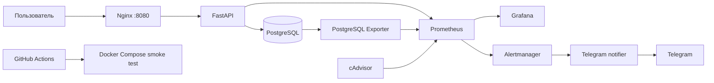

# Архитектура Infrastructure Lab

## Границы доступа

- Наружу опубликован только Nginx на `:8080`.
- PostgreSQL, API, экспортёр PostgreSQL и сервис Telegram находятся во
  внутренней Docker-сети.
- Prometheus, Alertmanager и Grafana привязаны к `127.0.0.1` и доступны только
  с компьютера, на котором запущен стенд.
- Секреты Telegram и базы данных хранятся только в локальном `.env`; файл
  исключён из Git.

## Поток инцидента

1. Prometheus опрашивает API и PostgreSQL каждые 15 секунд.
2. Правило фиксирует недоступность, высокий процент 5xx или высокую задержку.
3. Alertmanager группирует событие и передаёт его внутреннему notifier-сервису.
4. Notifier отправляет сообщение и последующее `RESOLVED`-уведомление в Telegram.
